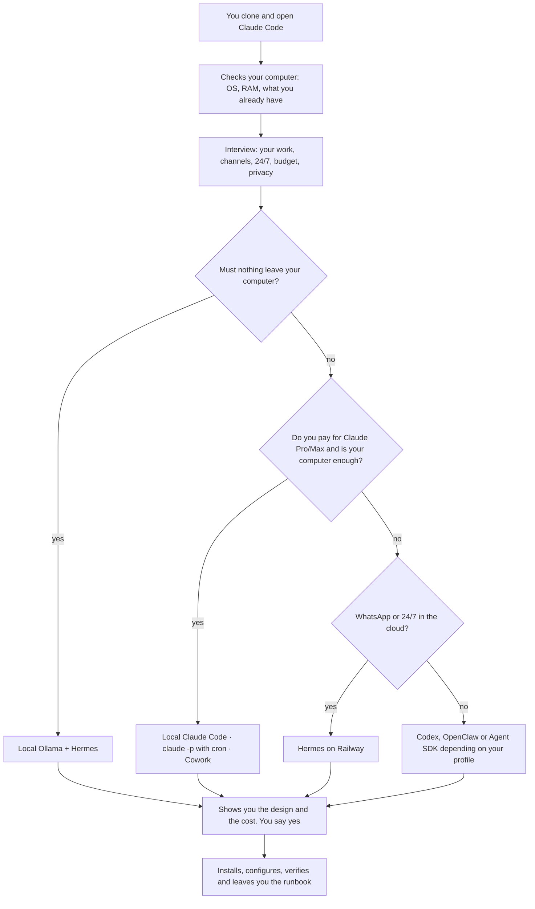

<p align="center">
  <picture>
    <source media="(prefers-color-scheme: dark) and (prefers-reduced-motion: reduce)" srcset="assets/hero-dark-static.svg">
    <source media="(prefers-color-scheme: light) and (prefers-reduced-motion: reduce)" srcset="assets/hero-light-static.svg">
    <source media="(prefers-color-scheme: dark)" srcset="assets/hero-dark.svg">
    <source media="(prefers-color-scheme: light)" srcset="assets/hero-light.svg">
    
  </picture>
</p>

<p align="center">
  <a href="#quick-start"></a>
  <a href="#runtimes"></a>
  <a href="LICENSE"></a>
  <a href="https://github.com/Hainrixz/jarvis-architect/stargazers"></a>
  <a href="README.md"></a>
  <a href="README.en.md"></a>
</p>

<p align="center"><b>Tell it what you do. The architect decides the rest.</b></p>

<p align="center">
The "build your own Jarvis" videos tell you to "pick your model, pick your harness" and leave you there.
Jarvis Architect makes those choices for you: it interviews you about your work, picks the runtime, model, hosting, channels and tools with a reason for each one, and installs it with you until your Jarvis answers.
</p>

<p align="center">
  <a href="#what-it-looks-like">What it looks like</a> ·
  <a href="#quick-start">Quick start</a> ·
  <a href="#how-it-decides">How it decides</a> ·
  <a href="#what-you-get">What you get</a> ·
  <a href="#your-jarvis-with-a-face-the-panel">Panel</a> ·
  <a href="#your-jarvis-works-on-its-own-with-permission">Works alone</a> ·
  <a href="#it-learns-from-you">Learns</a> ·
  <a href="#it-understands-audio-video-photos-and-pdfs">Audio and video</a> ·
  <a href="#runtimes">Runtimes</a> ·
  <a href="#costs">Costs</a> ·
  <a href="#railway">Railway</a> ·
  <a href="#commands">Commands</a> ·
  <a href="#faq">FAQ</a>
</p>

---

## What it looks like

A real conversation from start to finish takes 20 to 40 minutes. Here is the opening, trimmed:

```text
Architect   Hi, I'm Jarvis Architect. I'll take a quick look at what you have
            installed (read-only, I won't change anything), then ask a few questions.
            ✓ macOS · 16 GB · Claude Code with your Claude account · no Node

Architect   What do you do, and what would you like your Jarvis to do for you?

You         I sell houses in Guadalajara. Leads reach me on WhatsApp at all
            hours and go cold. I want it to reply, filter them and pass me the good ones.

Architect   Got it. Three things so I decide well:
            Does it need to answer even when your computer is off?  → Yes, always
            Do you already pay for Claude or ChatGPT?               → Claude Pro
            How much do you want to spend per month, all in?        → $10–30 USD

Architect   Here's what I propose:
            Runtime    Hermes Agent on Railway (24/7, no need for your laptop)
            Channels   Official WhatsApp (Cloud API) for clients · Telegram for you
            Models     a cheap one to filter leads, a good one to talk
            Memory     markdown files + Hermes's own memory
            Jobs       lead summary at 07:03 · follow-up after 2 days
            Cost       ~$12–16 USD/month + WhatsApp template messages

            Two heads-ups: your Claude Pro can't be used inside Hermes
            (Anthropic's terms don't allow it), so it runs on an API key
            with a spend cap. And since you'll store client data, I'll have
            a privacy notice ready for you. Shall we?

You         Yes, go.

Architect   Starting. 1/14 · Your Jarvis folder created ✓
```

Nothing is installed or charged before that "yes".

## Quick start

**All you need beforehand:** Claude Code installed and a Claude account with access to Claude Code (Pro or Max plan, or an API key from the Console). Install it with your system's package manager; the official guide is at [code.claude.com/docs/en/setup](https://code.claude.com/docs/en/setup).

```bash
# macOS
brew install --cask claude-code

# Windows (PowerShell)
winget install Anthropic.ClaudeCode
winget install --id Git.Git -e   # Git is needed to clone and also for plugin mode
```

**If you don't have a Claude plan:** building your Jarvis with an API key is a one-time cost of about $5–20 USD,
depending on how long the session runs (estimate; details in [`knowledge/capabilities/costs.md`](knowledge/capabilities/costs.md) § 6).
In the Console, create a separate *workspace* for Claude Code with its own spend limit (never the
*Default Workspace*) and take the key from there. A free claude.ai account does not work with Claude Code.

Then clone the repo and open Claude Code inside it:

```bash
git clone https://github.com/Hainrixz/jarvis-architect && cd jarvis-architect && claude
```

1. Claude Code asks whether you trust the folder. The highlighted option starts on "No, exit": use the down arrow to pick "Yes, I trust this folder", then press Enter. That turns on the auto-start and the project's permissions. The prompt mentions pre-approved permissions: they are read-only checks (installed versions, RAM, OS, whether a key is set without printing it); nothing installs or deletes anything without asking you. Always open it from the `jarvis-architect` folder, not from your home folder.
2. The architect starts on its own and greets you.
3. If it hasn't started after a few seconds, type `/jarvis-start`.

> [!TIP]
> You can skip the first question by saying what you do right away, for example: `/jarvis-start I'm a nutritionist, I want it to remind me of appointments and summarize my email every morning`. In a hurry? `/jarvis-quick` asks only three questions and fills in the rest with defaults (same security rules).

**As a plugin, no clone needed.** From any folder, inside Claude Code:

```text
/plugin marketplace add Hainrixz/jarvis-architect
/plugin install jarvis-architect@jarvis-architect
/jarvis-architect:jarvis-start
```

In plugin mode the commands carry the `jarvis-architect:` prefix. Your Jarvis and its state are saved in the folder where you opened it, never inside the plugin.

> [!NOTE]
> Plugin mode doesn't auto-start and doesn't bring the repo's permission rules (the read-only command allowlist and the blocks on `sudo`, `curl | sh` and reading `.env`). The architect's own rules still apply, but Claude Code will ask permission for every check. If you can, clone the repo: it's the full experience.

## How it decides

It doesn't show you a menu of five options. It follows a written decision tree ([`knowledge/decision-tree.md`](knowledge/decision-tree.md)) and tells you what it chose and why. You can always change anything.



When two options tie, the winner is decided in this order: complying with each provider's terms, security, cost and, last, convenience. What you already pay for and already have installed counts for more than a new account.

## What you get

<table>
  <tr>
    <td width="50%" valign="top"><b>A runtime chosen for you</b><br>One of nine (Claude Code, Hermes, OpenClaw, Codex, Ollama, Agent SDK, Cowork…), with its version pinned and verified that same day.</td>
    <td width="50%" valign="top"><b>Memory that's yours</b><br>Markdown files (<code>SOUL.md</code>, <code>USER.md</code>, <code>MEMORY.md</code>…) you can read, edit and take to another runtime.</td>
  </tr>
  <tr>
    <td valign="top"><b>Channels</b><br>Telegram, WhatsApp (the official way), Discord, the Claude app or the terminal. It only answers you.</td>
    <td valign="top"><b>Tools over MCP</b><br>MCP is the standard way to connect Jarvis to your apps: email, calendar, Notion, CRM, invoicing. It starts read-only.</td>
  </tr>
  <tr>
    <td valign="top"><b>Scheduled jobs</b><br>A briefing every morning plus the recurring work of your trade (follow-ups, reports, reminders) in your own time zone.</td>
    <td valign="top"><b>Audio, video, photos and PDFs</b><br>Send it voice notes, recordings, videos, photos or PDFs and it understands them; audio and video are processed on your computer. It replies in text, or by voice if you ask. See <a href="#it-understands-audio-video-photos-and-pdfs">what it understands</a>.</td>
  </tr>
  <tr>
    <td valign="top"><b>Security from day one</b><br>Single-owner allowlist, sandbox, your approval for anything irreversible, secrets out of git and a spend cap. None of it can be skipped.</td>
    <td valign="top"><b>Runbook</b><br>A <code>RUNBOOK.md</code> and a <code>SECURITY.md</code> in your folder: how to start it, stop it, check on it and what to do when something breaks.</td>
  </tr>
  <tr>
    <td valign="top"><b>Works on its own (with permission)</b><br>Keeps your to-dos in <code>TASKS.md</code> and prepares drafts by itself three times a day. It never sends, pays or deletes without your yes. See <a href="#your-jarvis-works-on-its-own-with-permission">how it works alone</a>.</td>
    <td valign="top"><b>Learns from you</b><br>When you correct it, it learns right away and tells you in one line; "deshaz" (undo) removes it. It never learns to skip your permissions. See <a href="#it-learns-from-you">how it learns</a>.</td>
  </tr>
  <tr>
    <td colspan="2" valign="top"><b>Web panel</b><br>A page on your computer where you chat with your Jarvis, check its memory and approve the sensitive stuff without opening the terminal. See <a href="#your-jarvis-with-a-face-the-panel">the panel</a>.</td>
  </tr>
</table>

## Your Jarvis with a face: the panel

A Jarvis has three layers: the **engine** (the runtime that thinks and uses your tools), the **home** (where it lives: your computer or Railway) and the **face** (how you talk to it: Telegram, WhatsApp or the panel). The architect picks all three; the panel is the face that needs no app at all.

<table>
  <tr>
    <td align="center" valign="middle"></td>
    <td align="center" valign="middle"></td>
  </tr>
</table>

- **Chat:** write to your Jarvis from the browser and watch the reply come in as it's written.
- **Memory:** read and edit `MEMORY.md`, `USER.md`, `SOUL.md` and `HEARTBEAT.md`. Its permissions (`AGENTS.md`, `TOOLS.md`) are read-only.
- **Pendientes (to-dos):** your `TASKS.md` list, including what Jarvis prepares on its own. Change a state, snooze or mark done, and pause or resume the autopilot. A red badge counts what needs your OK.
- **Aprendizajes (learning):** the lessons it learned and the skills it created by itself, with their probation and an undo button for each.
- **Jobs:** see your scheduled tasks, when they ran and whether they succeeded, and run one right now.
- **Approvals:** before sending an email, paying or deleting anything, Jarvis shows you exactly what it's about to do and you say yes or no. Each approval expires after 5 minutes.
- **Status:** whether it's running, which runtime it uses and a log of what it has done.

It listens only on `127.0.0.1`, so nobody else on your network can see it. On a server it only starts with a password, and to reach it from your phone you use Tailscale, never an open port. With OpenClaw and Cowork you don't need it: they already ship their own interface. Details in [`knowledge/capabilities/web-ui.md`](knowledge/capabilities/web-ui.md) and [`templates/panel/`](templates/panel/README.md).

## Your Jarvis works on its own (with permission)

Your Jarvis keeps your to-dos in `TASKS.md`, one line per task: what it is, whose it is (yours, its own or someone else's), when it's due and how far it may go on its own. Say "remind me to call Luis on Thursday" or "I'll send Ana the quote on Friday" and it writes it down and confirms in one line.

Three times a day, Monday to Friday (10:13, 13:13 and 16:13), the **autopilot** runs: it reads the list, picks up to three tasks it can move forward, and leaves them ready for you. If there was nothing to do, it doesn't message you.

| It does this alone | It needs your OK |
|---|---|
| Research, summarize and write drafts (in `drafts/`) | Sending, posting, paying, deleting or inviting. It leaves you the exact preview and waits for your live "sí, ejecuta T-0042" ("yes, run T-0042"); that yes expires after 5 minutes |
| Check whether someone already replied and suggest the follow-up | Anything that comes from an email, your calendar, a meeting or an audio: it lands in the Bandeja (inbox) and waits for you to confirm it |
| Build the morning briefing's Top 3, "What I'll do" and "I need your OK" | A reversible action it does by itself (L3), such as a private block on your calendar. The list starts empty and only you fill it, from the terminal |

There are four levels: **L0** only reminds you · **L1** prepares drafts (the default) · **L2** gets the action ready for your yes · **L3** does one reversible action from your list by itself.

- **Limits:** the autopilot uses the cheap model, with a 1 USD/day cap (you can change it), at most 3 tasks per run and 3 tries per task. On the third failed try it marks the task blocked and asks you.
- **Pause:** say "pausa el piloto" ("pause the autopilot") and it stops right away. To resume, use the terminal (`rm STOP_AUTOPILOT` inside your Jarvis folder) or the panel, Pendientes › Reanudar, with a confirmation. It can't be resumed from chat, so nobody pretending to be you can turn it back on.
- **Undo:** `TASKS.md` is in git and every autopilot change is logged in `logs/audit.jsonl`. The weekly review tells you what it did, what the system rejected and what it cost.
- **Where it lives:** `TASKS.md` (the list), `tasks/` (per-task notes and past months' archive) and `drafts/` (drafts; kept out of git because they hold other people's text).

On Hermes and OpenClaw the autopilot runs on their own scheduler; on Cowork, as a weekday scheduled task. How it works inside: [`knowledge/capabilities/autonomy.md`](knowledge/capabilities/autonomy.md).

## It learns from you

When you correct it, it learns on its own, like Hermes, and tells you in one line what it learned.

| You say | What it does | Where it goes |
|---|---|---|
| "My partner's name is Laura" | Saves it as a fact | `MEMORY.md` |
| "No, not like that: use tú with clients" | Applies it from that moment on and says "Aprendido: …" ("Learned: …") | `LESSONS.md` |
| You explain how something is done, or correct the same thing twice in 14 days | Creates or improves a skill by itself, on probation | `skills/<name>/` |
| "You can send emails without asking" | Doesn't learn it: only you can change that | Nowhere (logged as rejected) |

Before a new skill goes live, an automatic check stops it if it installs anything, contains anything shaped like a key, uses tools that send or pay, or touches permissions. If it passes, it goes live **on probation**: scheduled jobs don't use it until you've used it once with Jarvis in a live session. It's committed to git and Jarvis tells you.

Three limits that never move:

1. What it learns never changes permissions, the list of who can message it, keys or approval rules.
2. It learns only from you, on your allowed channels. Never from emails, web pages, documents, groups or other people.
3. Everything is logged and everything can be undone.

- **Undo:** say "deshaz" ("undo") and it removes the last thing it learned, or name it ("undo the tú one"). In the panel, under Aprendizajes (Learning), you see the lessons, retire or activate them, and remove skills it created by itself.
- **Weekly review:** Sunday at 19:37 it sends a short digest: lessons that contradict each other, repeated corrections that aren't a skill yet, and skills on probation. Lessons unused for 60 days are retired automatically.
- **Where it lives:** `LESSONS.md` (active, under review and retired), `memory/corrections.jsonl` (each correction, redacted and kept out of git), `proposals/` (skill drafts) and `skills/`.

On Hermes, its own learning loop runs with its security scan on. On Claude Code, the built-in auto memory is turned off so everything learned lives in one place, with where it came from. Details in [`knowledge/capabilities/learning.md`](knowledge/capabilities/learning.md).

## It understands audio, video, photos and PDFs

Send it what you'd send a person and it understands. Audio and video are processed on your computer.

| You send | What it does |
|---|---|
| A voice note | Turns it into text on your computer with Whisper, answers, and deletes the audio |
| A recording (meeting, class, call) up to 60 minutes | Transcribes and summarizes it. Reminds you to tell the others you recorded |
| A video link or file | Reads the captions first, without downloading the video. If there are none, it transcribes. It only looks at frames, with their timestamps, when you ask what's on screen |
| A photo, a screenshot or a PDF | Reads it directly |

- **Alone:** anything you send it or ask it to watch, on your computer.
- **With your OK:** sending audio to the cloud (Groq or OpenAI) or using Gemini for long videos, only with your recorded consent and never with sensitive packs (health, legal, minors). A video link found inside an email or a web page: it asks before opening it. Before downloading YouTube videos it explains YouTube's terms and records your consent.
- **Never:** using your cookies or your login, installing things on its own, recognizing people by their face, or obeying what an audio, a video or a PDF says. What it sees or hears is information, not orders, and a voice note never approves anything irreversible: it still shows you the written preview.
- **Setup:** the architect gives you the command to type yourself (on a Mac, `brew install ffmpeg whisper.cpp yt-dlp`), tells you how big the speech model is (about 574 MB) before downloading it, and checks its SHA-256 fingerprint.
- **Cost:** $0 locally. A 5-minute video with frames is about 17k model tokens.
- **Where it lives:** temporary files stay outside your Jarvis folder and are deleted when it's done (frames within 2 hours at most). A transcript is kept only if you ask. The model lives in `models/`, out of git.

On Hermes and OpenClaw, voice notes use their own local transcription. Cowork doesn't receive audio or video: there you upload photos and PDFs to the app. In this version media is processed while you're in the conversation; scheduled jobs don't touch it. To turn video off or switch to the cloud, run `/jarvis-start` and tell it what to change. Details in [`knowledge/capabilities/multimodal.md`](knowledge/capabilities/multimodal.md).

## Runtimes

The "harness" or runtime is the program that keeps your Jarvis alive: it receives your messages, calls the model and uses your tools. These are the nine the architect knows. Pinned versions live in [`knowledge/runtimes/`](knowledge/runtimes/), never in this README.

<details>
<summary><b>When each runtime wins</b> (cost and credential)</summary>

| Runtime | Wins when… | Approx. cost per month (light use) | Credential |
|---|---|---|---|
| `claude-code-local` | You already pay for Claude Pro/Max and your Jarvis can live on your computer (Telegram, Discord, terminal or the Claude app) | $0 extra with your plan | Your Claude session (`/login`) or `ANTHROPIC_API_KEY` |
| `claude-p-cron` | You only want scheduled results (daily briefing, KPI report), no chat | $0 extra with your plan | `/login`, a `claude setup-token` token or an API key |
| `claude-code-server` | You want Claude Code as is, with its skills and plugins, running 24/7 on a server | ~$15–30 (API + Railway) | `ANTHROPIC_API_KEY` by default. Your subscription only as a flagged personal alternative, with your consent |
| `claude-agent-sdk` | You're a developer and want your own service: webhooks, web panel, database | ~$10 on Railway | API key, always |
| `hermes` | You need 24/7 in the cloud, official WhatsApp or Hermes' own built-in learning loop. It's the default in the cloud | ~$9–16 on Railway with light use, ~$20–46 with more scheduled jobs · ~$1–5 on your computer | `ANTHROPIC_API_KEY` or `OPENAI_API_KEY` (never your Claude login) |
| `openclaw` | You want its phone apps and lots of channels, or your ChatGPT, and you accept unofficial WhatsApp on a secondary number | ~$11–18 on Railway · $0 extra locally with ChatGPT | API key, Codex login or Sign in with ChatGPT (preview) |
| `codex-openai` | You pay for ChatGPT, you like the terminal and your Jarvis is for coding or desktop work | $0 extra with your plan | `codex login` with ChatGPT or `OPENAI_API_KEY` |
| `ollama-local` | "Nothing leaves my computer" and you have strong hardware (≥24 GB of VRAM or Apple Silicon with ≥32 GB). Paired with Hermes | ~$0 (plus power and hardware) | None |
| `cowork` | You pay for Claude, don't want to install anything, and the Claude app with connectors and scheduled tasks is enough | $0 extra with your plan | Your Claude plan |

The ranges come from [`knowledge/capabilities/costs.md`](knowledge/capabilities/costs.md) and the prices in [`knowledge/models.json`](knowledge/models.json), verified on 2026-10-06. The full credential rule is in [`knowledge/auth-matrix.md`](knowledge/auth-matrix.md).

</details>

## Costs

The expensive part is almost never the server, it's the model's tokens. That's why the architect uses a cheap model for routine work and a good one only for conversation.

<details>
<summary><b>Typical costs</b> (USD per month, verified on 2026-10-06)</summary>

Light use = about 20 conversations a day. Medium use = about 100 a day plus scheduled jobs.

| Combination | Light | Medium |
|---|---|---|
| Claude Code on your computer with Claude Pro / Max | $20 (Pro) | $100 (Max 5x) |
| Codex on your computer with ChatGPT Plus / Pro (price confirmed live before quoting you) | $20 | $100 |
| Hermes on Railway, OpenAI models (cheap + main) | $9–13 | $18–22 |
| Hermes on Railway, Claude models (cheap + main) | $12–16 | $42–46 |
| OpenClaw on Railway, OpenAI models | $11–15 | $20–24 |
| Agent SDK on Railway, Claude models | ~$10 | ~$41 |
| Hermes + Ollama on your own hardware | ~$0 | ~$0 |

Worth knowing before you say yes:

- Railway Hobby costs $5 a month and includes $5 of usage. A light Jarvis usually lands between $5 and $13 for hosting alone.
- Newer Claude models count ~30% more tokens for the same text. The architect already factors that into the quote.
- If you pay through OpenRouter, add its 5.5% fee.
- WhatsApp: replying within 24 hours is almost free at personal volume. Template messages (the ones Jarvis sends first) are charged per message depending on your country.
- Before anything goes live, the architect helps you set a spend cap with the model provider (and on Railway, if it applies).

Sources: [claude.com/pricing](https://claude.com/pricing) · [Claude API pricing](https://platform.claude.com/docs/en/about-claude/pricing) · [OpenAI pricing](https://developers.openai.com/api/docs/pricing) · [Railway plans](https://docs.railway.com/pricing/plans) · [OpenRouter](https://openrouter.ai/pricing) · [WhatsApp pricing](https://developers.facebook.com/documentation/business-messaging/whatsapp/pricing). Full breakdown in [`knowledge/capabilities/costs.md`](knowledge/capabilities/costs.md).

</details>

## Railway

If your Jarvis has to stay on even when you close your laptop, the architect deploys it to [Railway](https://railway.com) with you.

<details>
<summary><b>How it deploys to Railway</b></summary>

1. **An account on the Hobby plan**, never Free for anything 24/7: Free has half a GB of RAM and doesn't allow always-on restarts.
2. **A usage limit on Railway and a spend cap with the model provider**, before the first deploy.
3. **One service and one volume** for your Jarvis's memory, with a single replica. For a one-person Jarvis that's enough ("Tier A").
4. **Secrets in Railway variables**, never in the repo or the chat. You paste them into the dashboard yourself.
5. **Telegram works without a public domain** (polling). Official WhatsApp does need an HTTPS URL, which Railway gives you.
6. **Daily volume backups** turned on, and `/jarvis-doctor` to check it stays healthy.

The architect installs the Railway CLI with your package manager, prepares each command and shows you what it costs. No `railway up`, new project or volume gets created without your "yes" at that moment.

Railway has no GPUs, so local models (Ollama) live on your own hardware, not there. If your Jarvis needs a web panel, a database or separation between clients, it uses "Tier B" (service + Postgres).

Sources: [plans](https://docs.railway.com/pricing/plans) · [volumes](https://docs.railway.com/volumes/reference) · [cost control](https://docs.railway.com/pricing/cost-control) · [Telegram bots](https://docs.railway.com/guides/ai-discord-telegram-bot). Full guide in [`knowledge/capabilities/deploy-railway.md`](knowledge/capabilities/deploy-railway.md).

</details>

## Security and keys

> [!WARNING]
> **We will never ask you for your keys in the chat.** No API keys, no tokens, no passwords. You paste them straight into your Jarvis's `.env` file or into Railway's variables; the architect only checks that they exist, never their value. If you paste one by mistake, it won't repeat it, it tells you where it goes and recommends rotating it.
>
> **Your Claude Pro/Max subscription is only used inside the official `claude` program, by you.** Hermes, OpenClaw and the Agent SDK use API keys with a spend cap. Hermes's mode that poses as Claude Code with your subscription is banned here. Same with ChatGPT: your plan goes inside Codex or through Sign in with ChatGPT, not copied into other tools.
>
> **Unofficial WhatsApp (Baileys)** only if you accept it in writing and with a secondary number, never your main one: your account could get banned.

On top of that, every Jarvis ships with the controls in [`knowledge/security-checklist.md`](knowledge/security-checklist.md): it only answers you, runs in a sandbox, asks permission before sending, paying, deleting or issuing invoices, and nothing gets installed with `curl | sh` or `sudo`. If a provider only offers a script, it's downloaded, you're shown its SHA-256 fingerprint and you run it yourself.

## Commands

| Command | What it's for |
|---|---|
| `/jarvis-start` | Start, or pick up where you left off |
| `/jarvis-quick` | Express mode: three questions, defaults for the rest, same rules |
| `/jarvis-next` | Continue the build step by step (also after closing the terminal) |
| `/jarvis-doctor` | Check that your Jarvis is running, within budget and up to date |
| `/jarvis-add` | Add something: WhatsApp, your calendar, a skill, a scheduled job |
| `/jarvis-refresh` | For maintainers: re-verify versions, prices and policies |

As a plugin: `/jarvis-architect:jarvis-start`, `/jarvis-architect:jarvis-next`, and so on.

## Repo structure

```text
jarvis-architect/
├── CLAUDE.md                 # how Claude Code behaves when you open the repo
├── .claude/
│   ├── settings.json         # auto-start + permissions (what's allowed, asked, denied)
│   ├── agents/               # jarvis-architect, stack-researcher, workspace-writer, jarvis-validator
│   └── skills/               # jarvis-start, -quick, -next, -doctor, -add, -refresh
├── .claude-plugin/           # plugin.json + marketplace.json
├── questions/                # the interview, phase by phase (0-preflight … 4-construir)
├── knowledge/                # what the architect knows, with sources and dates
│   ├── decision-tree.md      # profile → runtime, hosting, credential
│   ├── auth-matrix.md        # which credential is allowed in each case
│   ├── security-checklist.md # mandatory SEC-NN controls
│   ├── compatibility.md      # combinations that don't work
│   ├── models.json           # models and prices per provider
│   ├── runtimes/             # one file per runtime, with pinned versions
│   ├── capabilities/         # channels, WhatsApp, memory, MCP, voice, autonomy, learning, media, costs, deploy
│   ├── professions/          # profession packs (creator, sales, health, restaurant…)
│   └── countries/            # mx, co, ar, es, other: WhatsApp, invoicing, data laws
├── templates/                # spec, tasks, Jarvis workspace, local and Railway templates
│   ├── workspace/            # each Jarvis's SOUL, USER, MEMORY, AGENTS, TASKS, LESSONS…
│   ├── skills-base/          # base skills: pending, autopilot, learn, transcribe, watch-video…
│   ├── local/                # supervisors, jobs/apply-ops.sh, bin/learn.sh, bin/promote-skill.sh, hooks
│   └── panel/                # Jarvis Panel: the local web app (chat, memory, to-dos, learning, approvals)
├── tests/                    # autonomy, learning and media tests (run in CI)
├── assets/                   # README images
├── SECURITY.md · CONTRIBUTING.md · CHANGELOG.md
└── LICENSE
```

Your Jarvis isn't stored here: it lives in its own folder, with its own git, and the build state in `.jarvis/`.

## FAQ

**Do I need to know how to code?**
No. If you choose "guide me step by step", the architect explains every term and every click. The only technical things you do are install Claude Code and paste three commands.

**How much does it cost?**
The repo is free. Your Jarvis costs whatever the model costs and, if it runs in the cloud, the hosting: from $0 extra if you already pay for Claude or ChatGPT and it lives on your computer, up to about $10–20 USD a month on Railway with light use. Before installing anything it shows you the quote. See [Costs](#costs).

**Can I use my Claude subscription?**
Yes, inside Claude Code (on your computer or with scheduled `claude -p`) and in Cowork, always by you. Not inside Hermes, OpenClaw or the Agent SDK: there, Anthropic's terms require an API key. If you want your Jarvis in another tool, the architect tells you upfront and sets you up with a capped API key.

**Can it live on WhatsApp?**
Yes. For serving clients it uses the official WhatsApp API (Cloud API) with your Meta Business account. For your personal chat with Jarvis, Telegram is recommended, because using WhatsApp as a general-purpose assistant is a gray area under Meta's rules. Unofficial bridges only with your consent and a secondary number.

**What happens to my data?**
Your Jarvis's memory is files in your folder or on your Railway volume. What you write to it travels to the model provider you choose. If nothing may leave your computer, there's a 100% local path with Ollama. If you'll handle client data, it tells you what your country's law requires (LFPDPPP in Mexico, Law 1581 in Colombia, Law 25.326 in Argentina, GDPR in Spain).

**Does it work on Windows?**
Yes. Claude Code installs with `winget`. To keep your Jarvis always on or sandboxed it uses WSL2, and the architect walks you through turning it on if needed.

**What if I close the terminal?**
Nothing is lost. Progress is saved in `.jarvis/`; come back with `/jarvis-start` or `/jarvis-next` and it picks up where it was. And once it's done, your Jarvis runs on its own (with a supervisor on your computer or on Railway), not tied to that window. If your computer goes to sleep, a local Jarvis pauses; it tells you that beforehand.

**Will it send emails or pay for things on its own?**
No. It only prepares: drafts, summaries and the exact preview of what it would do. Sending, posting, paying, deleting or inviting always waits for your yes at that moment, and scheduled jobs can't do it even if they tried. If you want it to do something reversible on its own, like blocking private time on your calendar, you add that yourself from the terminal. See [Works alone](#your-jarvis-works-on-its-own-with-permission).

**Can I switch runtimes later?**
Yes. Your Jarvis's memory and personality are portable markdown, so moving from Claude Code to Hermes, or from your computer to Railway, doesn't start from scratch. Run `/jarvis-start` again and tell it what you want to change.

**What if a version or a price changed?**
The architect doesn't trust its memory: before installing or quoting, a subagent re-checks versions, prices and policies against the official sources. If something changed, it tells you and uses the new figure.

**Can I build a Jarvis for my clients and charge them?**
Not with this repo. Jarvis Architect builds personal assistants. A product for other people needs each of them to use their own credential and different terms; the architect tells you so and stops.

## Contributing

Contributions in Spanish or English are welcome, especially:

- new profession packs in [`knowledge/professions/`](knowledge/professions/) and country packs in [`knowledge/countries/`](knowledge/countries/);
- fixes to versions, prices or policies, always with the source URL;
- real-world tests: tell us what the architect built for you and where it got stuck.

Before opening a PR, read [`CONTRIBUTING.md`](CONTRIBUTING.md) and the format in [`knowledge/README.md`](knowledge/README.md). Versions only go in `knowledge/runtimes/*.md` and `knowledge/models.json`, every fact carries its official source (anything the source doesn't confirm is marked `UNVERIFIED` so `/jarvis-refresh` re-checks it), and never commit your generated Jarvis or any secret.

## License

[MIT](LICENSE). Use it, change it, share it.

---

<p align="center">
  Made by <a href="https://tododeia.com">tododeia.com</a> · <a href="https://www.instagram.com/soyenriquerocha">@soyenriquerocha</a>
</p>

<p align="center">
  <a href="https://star-history.com/#Hainrixz/jarvis-architect&Date">
    <picture>
      <source media="(prefers-color-scheme: dark)" srcset="https://api.star-history.com/svg?repos=Hainrixz/jarvis-architect&type=Date&theme=dark">
      
    </picture>
  </a>
</p>
