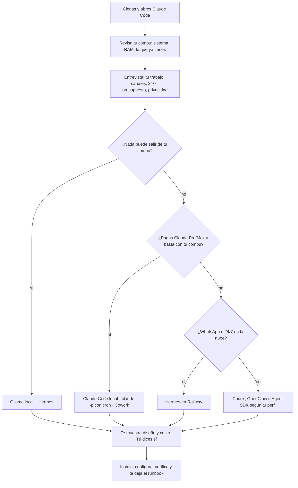
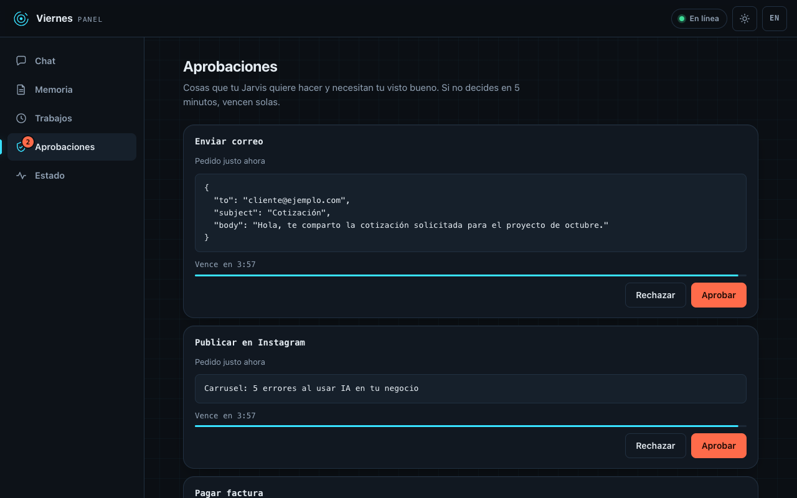
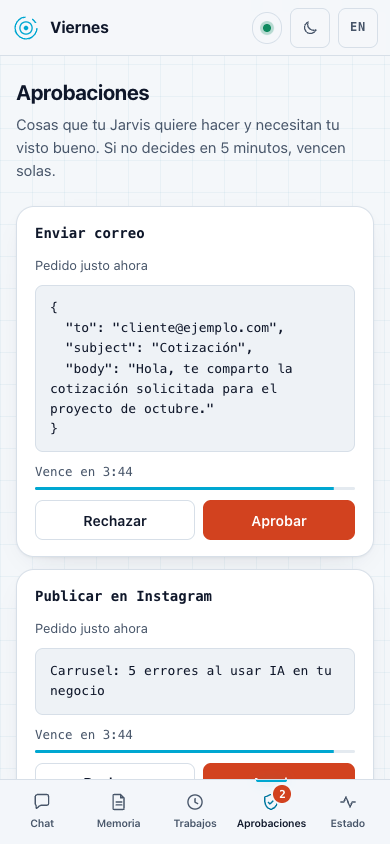

<p align="center">
  <picture>
    <source media="(prefers-color-scheme: dark) and (prefers-reduced-motion: reduce)" srcset="assets/hero-dark-static.svg">
    <source media="(prefers-color-scheme: light) and (prefers-reduced-motion: reduce)" srcset="assets/hero-light-static.svg">
    <source media="(prefers-color-scheme: dark)" srcset="assets/hero-dark.svg">
    <source media="(prefers-color-scheme: light)" srcset="assets/hero-light.svg">
    
  </picture>
</p>

<p align="center">
  <a href="#inicio-rápido"></a>
  <a href="#runtimes"></a>
  <a href="LICENSE"></a>
  <a href="https://github.com/Hainrixz/jarvis-architect/stargazers"></a>
  <a href="README.md"></a>
  <a href="README.en.md"></a>
</p>

<p align="center"><b>Dile a qué te dedicas. El arquitecto decide el resto.</b></p>

<p align="center">
Los videos de "arma tu propio Jarvis" te dicen "elige tu modelo, elige tu arnés" y ahí te dejan.
Jarvis Architect hace esas elecciones por ti: te entrevista sobre tu trabajo, escoge runtime, modelo, hosting, canales y herramientas con una razón para cada cosa, y lo instala contigo hasta que tu Jarvis contesta.
</p>

<p align="center">
  <a href="#así-se-ve">Así se ve</a> ·
  <a href="#inicio-rápido">Inicio rápido</a> ·
  <a href="#cómo-decide">Cómo decide</a> ·
  <a href="#qué-recibes">Qué recibes</a> ·
  <a href="#tu-jarvis-con-cara-el-panel">Panel</a> ·
  <a href="#runtimes">Runtimes</a> ·
  <a href="#costos">Costos</a> ·
  <a href="#railway">Railway</a> ·
  <a href="#comandos">Comandos</a> ·
  <a href="#preguntas-frecuentes">FAQ</a>
</p>

---

## Así se ve

Una conversación real de punta a punta dura entre 20 y 40 minutos. Esto es el arranque, recortado:

```text
Arquitecto  Hola, soy Jarvis Architect. Reviso rapidito qué tienes instalado
            (solo lectura, no cambio nada) y luego te hago unas preguntas.
            ✓ macOS · 16 GB · Claude Code con tu cuenta de Claude · sin Node

Arquitecto  ¿A qué te dedicas y qué te gustaría que tu Jarvis hiciera por ti?

Tú          Vendo casas en Guadalajara. Me llegan leads por WhatsApp a todas
            horas y se me enfrían. Quiero que conteste, filtre y me pase los buenos.

Arquitecto  Va. Tres cosas para decidir bien:
            ¿Tiene que contestar aunque tu compu esté apagada?   → Sí, siempre
            ¿Ya pagas Claude o ChatGPT?                          → Claude Pro
            ¿Cuánto quieres gastar al mes, todo incluido?        → $10–30 USD

Arquitecto  Esto te propongo:
            Runtime    Hermes Agent en Railway (24/7, sin depender de tu laptop)
            Canales    WhatsApp oficial (Cloud API) para clientes · Telegram para ti
            Modelos    uno barato para filtrar leads, uno bueno para conversar
            Memoria    archivos markdown + la memoria propia de Hermes
            Trabajos   resumen de leads a las 07:03 · seguimiento a los 2 días
            Costo      ~$12–16 USD/mes + mensajes de plantilla de WhatsApp

            Dos avisos: tu Claude Pro no se puede usar dentro de Hermes (los
            términos de Anthropic no lo permiten), así que va con una API key
            con tope de gasto. Y como vas a guardar datos de clientes, te dejo
            listo un aviso de privacidad. ¿Le damos?

Tú          Sí, dale.

Arquitecto  Arrancamos. 1/14 · Carpeta de tu Jarvis creada ✓
```

Nada se instala ni se cobra antes de ese "sí".

## Inicio rápido

**Lo único que necesitas antes:** Claude Code instalado y una cuenta de Claude con acceso a Claude Code (plan Pro o Max, o una API key de la Console). Instálalo con el gestor de paquetes de tu sistema; la guía oficial está en [code.claude.com/docs/en/setup](https://code.claude.com/docs/en/setup).

```bash
# macOS
brew install --cask claude-code

# Windows (PowerShell)
winget install Anthropic.ClaudeCode
winget install --id Git.Git -e   # Git es necesario para clonar y también para el modo plugin
```

**Si no tienes plan de Claude:** armar tu Jarvis con una API key cuesta una vez, aprox. $5–20 USD
según cuánto dure la sesión (estimado; detalle en [`knowledge/capabilities/costs.md`](knowledge/capabilities/costs.md) § 6).
Crea en la Console un *workspace* aparte para Claude Code con su propio límite de gasto (nunca el
*Default Workspace*) y saca la llave de ahí. Una cuenta gratis de claude.ai no sirve para Claude Code.

Después clona el repo y abre Claude Code adentro:

```bash
git clone https://github.com/Hainrixz/jarvis-architect && cd jarvis-architect && claude
```

1. Claude Code te pregunta si confías en la carpeta. Acepta: así se activan el arranque automático y los permisos del proyecto. Ábrelo siempre desde la carpeta `jarvis-architect`, no desde tu carpeta personal.
2. El arquitecto arranca solo y te saluda.
3. Si no arranca, escribe `/jarvis-start`.

> [!TIP]
> Puedes ahorrarte la primera pregunta escribiendo de una vez a qué te dedicas, por ejemplo: `/jarvis-start soy nutrióloga, quiero que me recuerde citas y me resuma mis correos cada mañana`. Si tienes prisa, `/jarvis-quick` hace solo tres preguntas y decide el resto con valores por defecto (mismas reglas de seguridad).

**Como plugin, sin clonar.** Desde cualquier carpeta, dentro de Claude Code:

```text
/plugin marketplace add Hainrixz/jarvis-architect
/plugin install jarvis-architect@jarvis-architect
/jarvis-architect:jarvis-start
```

En modo plugin los comandos llevan el prefijo `jarvis-architect:`. Tu Jarvis y su estado se guardan en la carpeta donde lo abriste, nunca dentro del plugin.

> [!NOTE]
> El modo plugin no arranca solo y no trae las reglas de permisos del repo (lista de comandos de solo lectura y bloqueos de `sudo`, `curl | sh` y lectura de `.env`). Las reglas del arquitecto siguen aplicando, pero Claude Code te va a pedir permiso para cada revisión. Si puedes, clona el repo: es la experiencia completa.

## Cómo decide

No te enseña un menú de cinco opciones. Sigue un árbol de decisión escrito ([`knowledge/decision-tree.md`](knowledge/decision-tree.md)) y te dice qué eligió y por qué. Siempre puedes cambiarle algo.



Cuando dos opciones empatan, gana en este orden: cumplir los términos de cada proveedor, seguridad, costo y, al final, comodidad. Lo que ya pagas y ya tienes instalado pesa más que una cuenta nueva.

## Qué recibes

<table>
  <tr>
    <td width="50%" valign="top"><b>Runtime elegido para ti</b><br>Uno de nueve (Claude Code, Hermes, OpenClaw, Codex, Ollama, Agent SDK, Cowork…), con la versión fijada y verificada ese mismo día.</td>
    <td width="50%" valign="top"><b>Memoria que es tuya</b><br>Archivos markdown (<code>SOUL.md</code>, <code>USER.md</code>, <code>MEMORY.md</code>…) que puedes leer, editar y llevarte a otro runtime.</td>
  </tr>
  <tr>
    <td valign="top"><b>Canales</b><br>Telegram, WhatsApp (por la vía oficial), Discord, la app de Claude o la terminal. Solo te contesta a ti.</td>
    <td valign="top"><b>Herramientas por MCP</b><br>MCP es la forma estándar de conectar a Jarvis con tus apps: correo, calendario, Notion, CRM, facturación. Empieza en solo lectura.</td>
  </tr>
  <tr>
    <td valign="top"><b>Trabajos automáticos</b><br>Un resumen cada mañana y los pendientes de tu oficio (seguimientos, reportes, recordatorios) a la hora de tu país.</td>
    <td valign="top"><b>Voz</b><br>Le mandas notas de voz como a cualquier contacto y te contesta por escrito, o con voz si lo pides. Hay opción 100 % local.</td>
  </tr>
  <tr>
    <td valign="top"><b>Seguridad desde el día uno</b><br>Lista de dueño único, sandbox, tu aprobación para todo lo irreversible, secretos fuera de git y tope de gasto. No se pueden saltar.</td>
    <td valign="top"><b>Runbook</b><br>Un <code>RUNBOOK.md</code> y un <code>SECURITY.md</code> en tu carpeta: cómo prenderlo, apagarlo, revisarlo y qué hacer si algo falla.</td>
  </tr>
  <tr>
    <td colspan="2" valign="top"><b>Panel web</b><br>Una página en tu compu para chatear con tu Jarvis, revisar su memoria y aprobar lo delicado sin abrir la terminal. Ver <a href="#tu-jarvis-con-cara-el-panel">el panel</a>.</td>
  </tr>
</table>

## Tu Jarvis con cara: el panel

Un Jarvis tiene tres capas: el **motor** (el runtime que piensa y usa tus herramientas), la **casa** (dónde vive: tu compu o Railway) y la **cara** (por dónde le hablas: Telegram, WhatsApp o el panel). El arquitecto elige las tres; el panel es la cara que no necesita ninguna app.

<table>
  <tr>
    <td align="center" valign="middle"></td>
    <td align="center" valign="middle"></td>
  </tr>
</table>

- **Chat:** le escribes a tu Jarvis desde el navegador y ves la respuesta mientras la escribe.
- **Memoria:** lees y editas `MEMORY.md`, `USER.md`, `SOUL.md` y `HEARTBEAT.md`. Sus permisos (`AGENTS.md`, `TOOLS.md`) solo se leen.
- **Trabajos:** ves tus tareas programadas, cuándo corrieron y si salieron bien, y puedes lanzar una en ese momento.
- **Aprobaciones:** antes de enviar un correo, pagar o borrar, Jarvis te enseña exactamente qué va a hacer y tú dices sí o no. Cada aprobación caduca a los 5 minutos.
- **Estado:** si está prendido, qué runtime usa y el registro de lo que ha hecho.

Escucha solo en `127.0.0.1`, así que nadie más en tu red lo ve. En un servidor solo arranca con contraseña, y para entrar desde el celular se usa Tailscale, nunca un puerto abierto. Con OpenClaw y Cowork no hace falta: esos ya traen su propia interfaz. Detalles en [`knowledge/capabilities/web-ui.md`](knowledge/capabilities/web-ui.md) y [`templates/panel/`](templates/panel/README.md).

## Runtimes

El "arnés" o runtime es el programa que mantiene vivo a tu Jarvis: recibe tus mensajes, llama al modelo y usa tus herramientas. Estos son los nueve que conoce el arquitecto. Las versiones fijadas están en [`knowledge/runtimes/`](knowledge/runtimes/) y nunca en este README.

<details>
<summary><b>Cuándo gana cada runtime</b> (costo y credencial)</summary>

| Runtime | Gana cuando… | Costo aprox. al mes (uso ligero) | Credencial |
|---|---|---|---|
| `claude-code-local` | Ya pagas Claude Pro/Max y tu Jarvis puede vivir en tu compu (Telegram, Discord, terminal o la app de Claude) | $0 extra con tu plan | Tu sesión de Claude (`/login`) o `ANTHROPIC_API_KEY` |
| `claude-p-cron` | Solo quieres resultados programados (briefing diario, reporte de KPIs), sin chat | $0 extra con tu plan | `/login`, token de `claude setup-token` o API key |
| `claude-code-server` | Quieres Claude Code tal cual, con sus skills y plugins, prendido 24/7 en un servidor | ~$15–30 (API + Railway) | `ANTHROPIC_API_KEY` por defecto. Tu suscripción solo como alternativa personal marcada, con tu consentimiento |
| `claude-agent-sdk` | Eres dev y quieres tu propio servicio: webhooks, panel web, base de datos | ~$10 en Railway | API key, siempre |
| `hermes` | Necesitas 24/7 en la nube, WhatsApp oficial o un Jarvis que aprende de ti. Es la opción por defecto en la nube | ~$9–16 en Railway con uso ligero, ~$20–46 con más trabajos programados · ~$1–5 en tu compu | `ANTHROPIC_API_KEY` u `OPENAI_API_KEY` (nunca tu login de Claude) |
| `openclaw` | Quieres sus apps de teléfono y muchos canales, o tu ChatGPT, y aceptas WhatsApp no oficial con un número secundario | ~$11–18 en Railway · $0 extra local con ChatGPT | API key, Codex login o Sign in with ChatGPT (preview) |
| `codex-openai` | Pagas ChatGPT, te late la terminal y tu Jarvis es para trabajo de código o de escritorio | $0 extra con tu plan | `codex login` con ChatGPT u `OPENAI_API_KEY` |
| `ollama-local` | "Nada sale de mi compu" y tienes equipo potente (≥24 GB de VRAM o Apple Silicon con ≥32 GB). Va junto con Hermes | ~$0 (más luz y equipo) | Ninguna |
| `cowork` | Pagas Claude, no quieres instalar nada y te basta la app de Claude con conectores y tareas programadas | $0 extra con tu plan | Tu plan de Claude |

Los rangos salen de [`knowledge/capabilities/costs.md`](knowledge/capabilities/costs.md) y de los precios en [`knowledge/models.json`](knowledge/models.json), verificados el 2026-10-06. La regla de credenciales completa está en [`knowledge/auth-matrix.md`](knowledge/auth-matrix.md).

</details>

## Costos

Lo que más cuesta casi nunca es el servidor, son los tokens del modelo. Por eso el arquitecto usa un modelo barato para lo rutinario y uno bueno solo para conversar.

<details>
<summary><b>Costos típicos</b> (USD al mes, verificados el 2026-10-06)</summary>

Uso ligero = unas 20 conversaciones al día. Uso medio = unas 100 al día más trabajos programados.

| Combinación | Ligero | Medio |
|---|---|---|
| Claude Code en tu compu con Claude Pro / Max | $20 (Pro) | $100 (Max 5x) |
| Codex en tu compu con ChatGPT Plus / Pro (precios UNVERIFIED) | $20 | $100 |
| Hermes en Railway, modelos de OpenAI (barato + principal) | $9–13 | $18–22 |
| Hermes en Railway, modelos de Claude (barato + principal) | $12–16 | $42–46 |
| OpenClaw en Railway, modelos de OpenAI | $11–15 | $20–24 |
| Agent SDK en Railway, modelos de Claude | ~$10 | ~$41 |
| Hermes + Ollama en tu propio equipo | ~$0 | ~$0 |

Lo que conviene saber antes de decir que sí:

- Railway Hobby cuesta $5 al mes e incluye $5 de uso. Un Jarvis ligero suele quedar entre $5 y $13 solo de hosting.
- Los modelos nuevos de Claude cuentan ~30 % más tokens por el mismo texto. El arquitecto ya lo incluye en la cotización.
- Si pagas por OpenRouter, súmale su comisión de 5.5 %.
- WhatsApp: contestar dentro de las 24 horas sale casi gratis a volumen personal. Los mensajes de plantilla (los que Jarvis manda primero) se cobran por mensaje según tu país.
- Antes de que algo quede en línea, el arquitecto te ayuda a poner un tope de gasto con el proveedor del modelo (y en Railway, si aplica).

Fuentes: [claude.com/pricing](https://claude.com/pricing) · [precios de la API de Claude](https://platform.claude.com/docs/en/about-claude/pricing) · [precios de OpenAI](https://developers.openai.com/api/docs/pricing) · [planes de Railway](https://docs.railway.com/pricing/plans) · [OpenRouter](https://openrouter.ai/pricing) · [precios de WhatsApp](https://developers.facebook.com/documentation/business-messaging/whatsapp/pricing). Detalle completo en [`knowledge/capabilities/costs.md`](knowledge/capabilities/costs.md).

</details>

## Railway

Si tu Jarvis tiene que estar prendido aunque cierres la laptop, el arquitecto lo sube a [Railway](https://railway.com) contigo.

<details>
<summary><b>Cómo se despliega en Railway</b></summary>

1. **Cuenta en plan Hobby**, nunca Free para algo 24/7: Free tiene medio GB de RAM y no deja reiniciar siempre.
2. **Límite de uso en Railway y tope de gasto en el proveedor del modelo**, antes del primer despliegue.
3. **Un servicio y un volumen** para la memoria de tu Jarvis, con una sola réplica. Para un Jarvis de una persona alcanza ("Tier A").
4. **Secretos en las variables de Railway**, nunca en el repo ni en el chat. Tú los pegas en el panel.
5. **Telegram funciona sin dominio público** (polling). WhatsApp oficial sí necesita una URL HTTPS, que Railway te da.
6. **Copias diarias del volumen** activadas, y `/jarvis-doctor` para revisar que siga sano.

El arquitecto instala el CLI de Railway con tu gestor de paquetes, prepara cada comando y te enseña cuánto cuesta. Ningún `railway up`, proyecto nuevo o volumen se crea sin tu "sí" en ese mismo momento.

Railway no tiene GPUs, así que los modelos locales (Ollama) viven en tu propio equipo, no ahí. Si tu Jarvis necesita panel web, base de datos o separar clientes, se usa "Tier B" (servicio + Postgres).

Fuentes: [planes](https://docs.railway.com/pricing/plans) · [volúmenes](https://docs.railway.com/volumes/reference) · [control de costos](https://docs.railway.com/pricing/cost-control) · [bots de Telegram](https://docs.railway.com/guides/ai-discord-telegram-bot). Guía completa en [`knowledge/capabilities/deploy-railway.md`](knowledge/capabilities/deploy-railway.md).

</details>

## Seguridad y llaves

> [!WARNING]
> **Nunca te vamos a pedir tus llaves en el chat.** Ni API keys, ni tokens, ni contraseñas. Tú las pegas directo en el archivo `.env` de tu Jarvis o en las variables de Railway; el arquitecto solo revisa si existen, nunca su valor. Si pegas una por error, no la repite, te dice dónde va y te recomienda cambiarla.
>
> **Tu suscripción de Claude Pro/Max solo se usa dentro del programa oficial `claude`, por ti.** Hermes, OpenClaw y el Agent SDK usan API keys con tope de gasto. El modo de Hermes que se hace pasar por Claude Code con tu suscripción está prohibido aquí. Lo mismo con ChatGPT: tu plan va dentro de Codex o por Sign in with ChatGPT, no copiado a otras herramientas.
>
> **WhatsApp no oficial (Baileys)** solo si lo aceptas por escrito y con un número secundario, nunca el tuyo principal: hay riesgo de que te bloqueen la cuenta.

Además, todo Jarvis sale con los controles de [`knowledge/security-checklist.md`](knowledge/security-checklist.md): solo te contesta a ti, corre en sandbox, te pide permiso antes de enviar, pagar, borrar o timbrar, y nada se instala con `curl | sh` ni con `sudo`. Si un proveedor solo ofrece un script, se descarga, te enseña su huella SHA-256 y lo corres tú.

## Comandos

| Comando | Para qué |
|---|---|
| `/jarvis-start` | Empezar, o seguir donde te quedaste |
| `/jarvis-quick` | Modo express: tres preguntas, el resto por defecto, mismas reglas |
| `/jarvis-next` | Continuar la construcción paso a paso (también después de cerrar la terminal) |
| `/jarvis-doctor` | Revisar que tu Jarvis esté prendido, dentro del presupuesto y actualizado |
| `/jarvis-add` | Agregarle algo: WhatsApp, tu calendario, una skill, un trabajo programado |
| `/jarvis-refresh` | Para quien mantiene el repo: volver a verificar versiones, precios y políticas |

Como plugin: `/jarvis-architect:jarvis-start`, `/jarvis-architect:jarvis-next`, etc.

## Estructura del repo

```text
jarvis-architect/
├── CLAUDE.md                 # cómo se comporta Claude Code al abrir el repo
├── .claude/
│   ├── settings.json         # arranque automático + permisos (qué se permite, qué se pregunta, qué se niega)
│   ├── agents/               # jarvis-architect, stack-researcher, workspace-writer, jarvis-validator
│   └── skills/               # jarvis-start, -quick, -next, -doctor, -add, -refresh
├── .claude-plugin/           # plugin.json + marketplace.json
├── questions/                # la entrevista, fase por fase (0-preflight … 4-construir)
├── knowledge/                # lo que sabe el arquitecto, con fuentes y fecha
│   ├── decision-tree.md      # perfil → runtime, hosting, credencial
│   ├── auth-matrix.md        # qué credencial se permite en cada caso
│   ├── security-checklist.md # controles SEC-NN obligatorios
│   ├── compatibility.md      # combinaciones que no funcionan
│   ├── models.json           # modelos y precios por proveedor
│   ├── runtimes/             # un archivo por runtime, con versiones fijadas
│   ├── capabilities/         # canales, WhatsApp, memoria, MCP, voz, costos, despliegue
│   ├── professions/          # paquetes por oficio (creador, ventas, salud, restaurante…)
│   └── countries/            # mx, co, ar, es, other: WhatsApp, facturación, leyes de datos
├── templates/                # spec, tareas, workspace del Jarvis, plantillas local y Railway
│   └── panel/                # Jarvis Panel: la app web local (chat, memoria, trabajos, aprobaciones)
├── assets/                   # imágenes del README
├── SECURITY.md · CONTRIBUTING.md · CHANGELOG.md
└── LICENSE
```

Tu Jarvis no se guarda aquí: vive en su propia carpeta, con su propio git, y el estado de la construcción en `.jarvis/`.

## Preguntas frecuentes

**¿Necesito saber programar?**
No. Si eliges "guíame paso a paso", el arquitecto te explica cada término y cada clic. Lo único técnico que haces es instalar Claude Code y pegar tres comandos.

**¿Cuánto cuesta?**
El repo es gratis. Tu Jarvis cuesta lo que cueste el modelo y, si va en la nube, el hosting: desde $0 extra si ya pagas Claude o ChatGPT y vive en tu compu, hasta unos $10–20 USD al mes en Railway con uso ligero. Antes de instalar nada te enseña la cotización. Ver [Costos](#costos).

**¿Puedo usar mi suscripción de Claude?**
Sí, dentro de Claude Code (en tu compu o con `claude -p` programado) y en Cowork, siempre por ti. No dentro de Hermes, OpenClaw ni el Agent SDK: ahí los términos de Anthropic piden API key. Si quieres tu Jarvis en otra herramienta, el arquitecto te lo dice antes y te arma la API key con tope.

**¿Puede vivir en WhatsApp?**
Sí. Para atender clientes se usa la API oficial de WhatsApp (Cloud API) con tu cuenta de Meta Business. Para tu chat personal con Jarvis se recomienda Telegram, porque usar WhatsApp como asistente de propósito general está en zona gris con las reglas de Meta. Los puentes no oficiales solo con tu consentimiento y un número secundario.

**¿Qué pasa con mis datos?**
La memoria de tu Jarvis son archivos en tu carpeta o en tu volumen de Railway. Lo que le escribes viaja al proveedor del modelo que elijas. Si nada puede salir de tu compu, existe la ruta 100 % local con Ollama. Si vas a manejar datos de clientes, te avisa qué pide la ley de tu país (LFPDPPP en México, Ley 1581 en Colombia, Ley 25.326 en Argentina, RGPD en España).

**¿Funciona en Windows?**
Sí. Claude Code se instala con `winget`. Para que tu Jarvis corra siempre prendido o en sandbox se usa WSL2, y el arquitecto te guía para activarlo si hace falta.

**¿Qué pasa si cierro la terminal?**
Nada se pierde. El avance queda guardado en `.jarvis/`; vuelves con `/jarvis-start` o `/jarvis-next` y sigue donde iba. Y ya terminado, tu Jarvis corre por su cuenta (con un supervisor en tu compu o en Railway), no depende de esa ventana. Si tu compu se duerme, un Jarvis local se pausa; eso te lo dice antes.

**¿Puedo cambiar de runtime después?**
Sí. La memoria y la personalidad de tu Jarvis son markdown portable, así que mudarte de Claude Code a Hermes, o de tu compu a Railway, no empieza de cero. Corre `/jarvis-start` otra vez y dile qué quieres cambiar.

**¿Y si una versión o un precio cambió?**
El arquitecto no confía en su memoria: antes de instalar o cotizar, un subagente vuelve a revisar versiones, precios y políticas en las fuentes oficiales. Si algo cambió, te lo dice y usa el dato nuevo.

**¿Puedo hacer un Jarvis para mis clientes y cobrarles?**
No con este repo. Jarvis Architect arma asistentes personales. Un producto para otras personas necesita que cada una use su propia credencial y otros términos; el arquitecto te lo dice y se detiene.

## Contribuir

Las contribuciones en español o inglés son bienvenidas, sobre todo:

- paquetes de oficio nuevos en [`knowledge/professions/`](knowledge/professions/) y de país en [`knowledge/countries/`](knowledge/countries/);
- correcciones de versiones, precios o políticas, siempre con la URL de la fuente;
- pruebas reales: cuéntanos qué te armó el arquitecto y dónde se trabó.

Antes de abrir un PR lee [`CONTRIBUTING.md`](CONTRIBUTING.md) y el formato de [`knowledge/README.md`](knowledge/README.md). Las versiones solo van en `knowledge/runtimes/*.md` y `knowledge/models.json`, lo que no esté confirmado se marca `UNVERIFIED`, y nunca subas tu Jarvis generado ni ningún secreto.

## Licencia

[MIT](LICENSE). Úsalo, cámbialo, compártelo.

---

<p align="center">
  Hecho por <a href="https://tododeia.com">tododeia.com</a> · <a href="https://www.instagram.com/soyenriquerocha">@soyenriquerocha</a>
</p>

<p align="center">
  <a href="https://star-history.com/#Hainrixz/jarvis-architect&Date">
    <picture>
      <source media="(prefers-color-scheme: dark)" srcset="https://api.star-history.com/svg?repos=Hainrixz/jarvis-architect&type=Date&theme=dark">
      
    </picture>
  </a>
</p>
